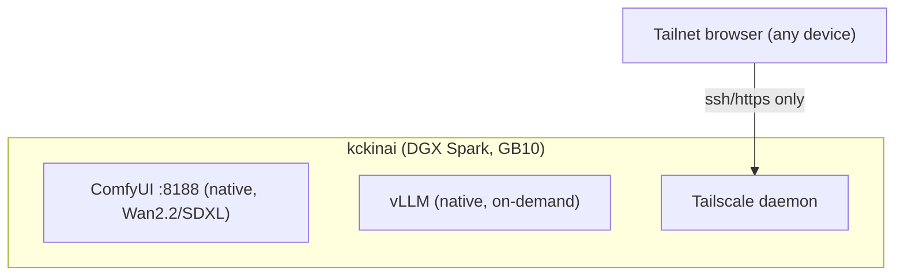
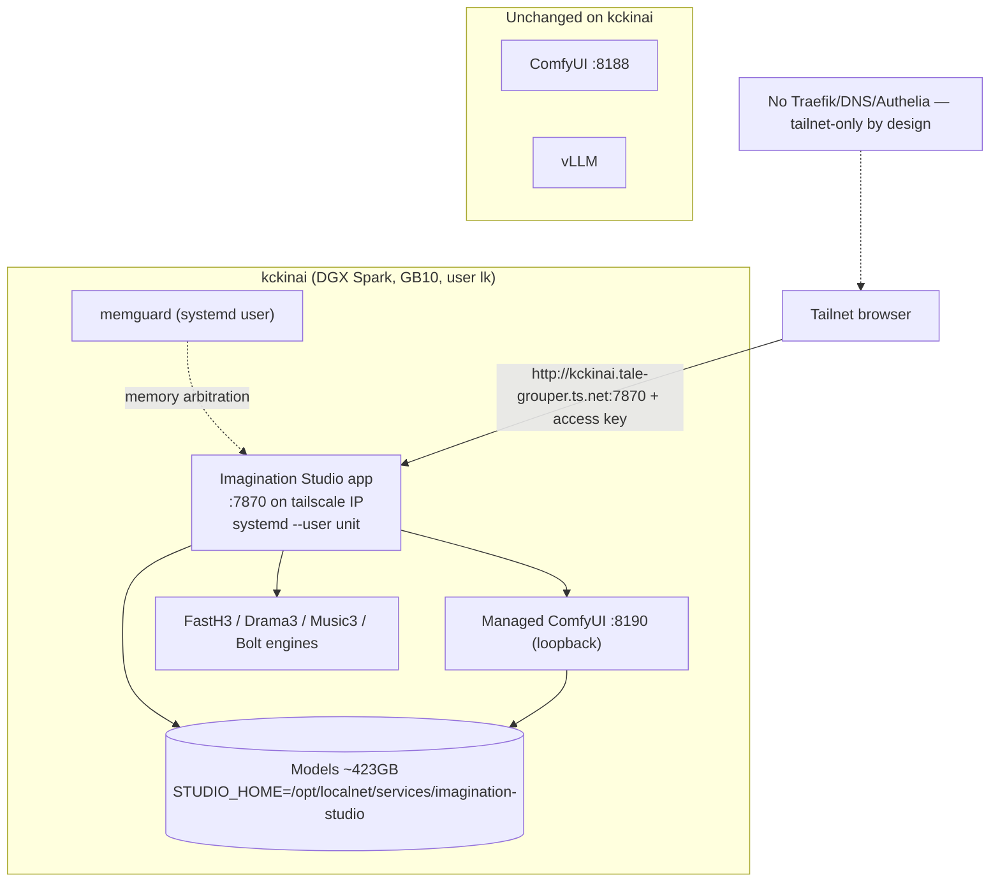

---
# Product Requirements Document (PRD)

feature_slug: imagination-studio
created: 2026-11-17
completed:
last-activity: 2026-11-17
status: done
tech_context:
  install_type: native             # upstream installer on DGX OS, NOT containers
  target_host: kckinai             # DGX Spark, GB10, arm64, DGX OS
  run_user: lk                     # localnet_kckinai_ansible_user
  app_port: 7870                   # tailnet-IP bind (HOST env)
  managed_comfy_port: 8190         # loopback only, app-spawned
  exposure: tailnet-only           # HOST=<tailscale ip> + access key
  never_use: [docker compose, hardcoded IPs/ports, vault_hf_token (persisted auth on host)]
---

# Product Requirements Document (PRD)

## Introduction / Overview

- **Feature name:** Imagination Studio deployment to kckinai (infrahub)
- **Summary:** Deploy
  [Imagination Studio](https://github.com/Keys-Wasserman/Imagination-Studio-by-keys-Wasserman)
  (v4.2.1, Apache-2.0 — AI film studio powered by TensorFold: planning,
  Qwen-Image/FLUX3 picture generation, FastH3/MiniMax video with sound,
  Drama3 voices, Music3/YuE2 songs, Bolt brain) onto `kckinai` — the levonk
  DGX Spark (GB10, 128 GB unified memory) — as a **native** install under
  user `lk`, exposed tailnet-only. No Windows-side components.
- **Context:**
  - Upstream supports DGX Spark via `oneshot-setup-spark.sh` →
    `oneshot-setup-cuda.sh` (~125 GB core, ~423 GB with `--all
    --h3-image`); installs engines, models, a managed ComfyUI (:8190),
    and a systemd-user memory guard — all user-level, nothing as root.
  - Head-only job kinds (voice, music, long-video chains, `studio` kind,
    LoRA training) require GB10 engines → native head on the Spark is the
    only fully-featured topology. Container-head alternatives rejected —
    see research `alternatives.md`.
  - Research: `internal-docs/research/service/imagination-studio/`
    (overview, deployment, configuration, security, alternatives —
    committed in PR #51).

## Goals

- Native Studio install on kckinai as `lk`: code checkout (pinned ref),
  deps, systemd `--user` app unit + `loginctl enable-linger`, memguard.
- App bound to the kckinai Tailscale IP only (`HOST=<ts ip>`), port 7870,
  access-key enforced — reachable as
  `http://kckinai.tale-grouper.ts.net:7870` from tailnet devices.
- `STUDIO_HOME=/opt/localnet/services/imagination-studio` (infra storage
  convention, matches comfyui/postiz precedent).
- `oneshot-setup-spark.sh --all --h3-image` model install via a dedicated
  **async** playbook with poll — ~423 GB of downloads cannot run inside a
  synchronous Ansible task.
- `infra_*`/`vault_*` variable discipline, `services.yml` catalog entry,
  regenerated catalogs, `just ansible-deploy-imagination-studio` +
  `ansible-validate-imagination-studio` recipes, devbox.json script
  entries, AGENTS.md playbook-mapping row.
- **No vault items** — `~lk/.cache/huggingface/token` (account `Thren`)
  already persisted and verified for both gated repos.

## User Stories

- **As the operator**, I run `just ansible-deploy-imagination-studio` and
  get the Studio code + service unit on kckinai without manual SSH.
- **As the operator**, I run the async model-install playbook once, poll
  progress, and get ~423 GB of models without babysitting a terminal.
- **As a tailnet user**, I open
  `http://kckinai.tale-grouper.ts.net:7870/?key=<access-key>` and use the
  full Studio (plan, generate pictures/video/voices/music, edit, export).
- **As the operator**, I confirm nothing else on kckinai is disturbed:
  ComfyUI :8188, vLLM, and other localnet services keep working; Studio's
  memory guard arbitrates unified memory.

## Functional Requirements

1. **Infrastructure variables** — shared
   `infrastructure/ports.yml`: `infra_port_ai_studio_{host,container}` =
   7870; `infrastructure/storage.yml`: `infra_storage_studio_*` (base dir
   `/opt/localnet/services/imagination-studio`, model/PREFIX dir,
   STUDIO_HOME subdir, hf-cache); check + register managed-comfy 8190 as
   loopback (conflict tracking, not published). Levonk
   `levonk/.../infrastructure/` overrides only where client values
   differ. `services.yml` catalog entry (machine `kckinai`, category
   `ai`, probe `GET /api/spark/self` via tcp/http on tailnet IP:7870).
2. **Role `ai-imagination-studio`** —
   `shared/active/02-config/ansible/roles/ai-imagination-studio/`,
   native-install role following `ai-comfyui` precedent (native on
   kckinai, `localnet_hosts` dispatch): validate vars → ensure dirs
   (PREFIX/STUDIO_HOME, owner `lk`) → ensure deps (git, ffmpeg,
   python3+venv, rsync, openssh, docker already present on DGX OS) →
   clone repo at pinned ref (VERSION file: 4.2.1 or tag/commit) → write
   env file (HOST=tailnet ip, PORT, STUDIO_HOME, PREFIX,
   STUDIO_MEMORY_MANAGER on) → install systemd `--user` unit
   (`scripts/app.sh` or `app/server.py` entrypoint per upstream docs) +
   `loginctl enable-linger lk` → memguard status check → enable/start
   service → verify `/api/spark/self` answers on the tailnet IP.
3. **Model install playbook** —
   `playbooks/deploy-imagination-studio-models.yml`: separate playbook
   running `oneshot-setup-spark.sh --all --h3-image` as `lk` via
   `ansible.builtin.command` + `async`/`poll: 0`, status file under
   STUDIO_HOME for progress polling, plus a `--verify` re-run path and a
   `validate` tag path. NOT part of the service deploy playbook.
4. **Deploy + validate playbooks** —
   `playbooks/deploy-imagination-studio.yml` (deps+vars assert →
   `ai-imagination-studio` role; tags per concern) and
   `playbooks/validate-imagination-studio.yml` (read-only:
   service active, port bound to tailscale IP only, `/api/spark/self`
   fields, disk headroom, memguard unit present, no foreign-port
   conflicts). Three-layer validation per Ansible AGENTS.md.
5. **Recipes + docs** — `just ansible-deploy-imagination-studio`,
   `ansible-deploy-imagination-studio-models`,
   `ansible-validate-imagination-studio` (+ `-internal` variants where the
   repo uses them); devbox.json script entries; Ansible AGENTS.md
   "Playbook-to-Inventory Mapping" row; SERVICES.md entries (shared +
   levonk copies).

## Non-Functional Requirements

- **Security:** tailnet-only bind (never `0.0.0.0`, never LAN). Access
  key on (default). memguard default — never `--memguard-stop-foreign`
  (would let it kill vLLM). Role never reads/logs the HF token file.
  License flags recorded in security.md — non-commercial weights
  (Qwen base, YuE2, MMAudio, FLUX3-K) shipped per user decision;
  MiniMax territory clause noted.
- **Idempotency:** installer is re-runnable (`--verify`); role tasks
  use `creates:`/state checks; service unit template idempotent.
- **Reproducibility:** pin upstream ref (tag/commit) via variable
  `ai_studio_ref`; document upgrade path (`git pull` + `--upgrade`).
- **Coexistence:** no port conflicts (7870/8190 free in ports.yml;
  8188 ComfyUI untouched); model tree disjoint from existing ComfyUI;
  memory guard shares box politely.
- **Host mutation:** all host changes via committed Ansible tasks;
  first model-install run is a user-invoked playbook, not embedded in
  deploy.

## Current State

- **Relevant files and their roles:**
  - `shared/active/02-config/ansible/roles/ai-comfyui/` — **canonical
    precedent**: native (non-container) install on kckinai — venv, git
    clone, systemd, dirs under `infra_storage_services_dir`.
  - `shared/active/02-config/ansible/playbooks/bootstrap-ai-inference-host.yml`
    — kckinai bootstrap precedent (tailscale + collector, `--limit kckinai`).
  - `shared/active/02-config/ansible/infrastructure/{ports,storage,services,domains}.yml`
    — shared schemas; comfyui entries at ports.yml:753-756,
    storage.yml:365-377, services.yml:1853+ (machine `kckinai`).
  - `levonk/active/02-config/ansible/inventories/localnet.yml` —
    `localnet_hosts` inventory; kckinai vars in
    `group_vars/localnet_hosts.yml` (`localnet_kckinai_*`).
  - `levonk/active/02-config/ansible/infrastructure/ports.yml:103-106` —
    client comfyui port override precedent.
  - `.agents/workflows/infrahub-add-new-service.md` — implementation
    guide (Phases 1-8) the task stories follow.
  - Upstream (cloned `/tmp/imagination-studio-src`, v4.2.1):
    `oneshot-setup-spark.sh` → `oneshot-setup-cuda.sh` (flag parsing at
    line ~142: `--all` expands to SWAP REF2VA H3_BASE IMAGE_EDIT FLUX3
    MOSS MUSIC YUE2 SOUND BOLT VOICE MOTION TRAIN GRAPHICS FINISH;
    `--h3-image` excluded); `scripts/app.sh` launcher (`HOST`,`PORT`,
    `STUDIO_HOME` env); `scripts/memguard.py install` (systemd-user
    precedent); `app/access.py` access-key model; `app/sparks.py`
    `KINDS=("video")` + `here_only` head-pinning.
- **Repository conventions:**
  - All container lifecycle via `community.docker` modules — N/A here
    (native install), but same discipline: no shell-compose patterns.
  - ALL ports/IPs/paths as `infra_*` vars — shared schema + client
    override; never hardcode (AGENTS.md "IP and Port Configuration").
  - Role naming: functional prefix `ai-` (ai-comfyui, ai-litellm,
    ai-freellmapi, ai-treg precedents).
  - Validation: `validate-<svc>.yml` playbook + role verify tags +
    `just ansible-validate-<svc>` + devbox.json script (Ansible AGENTS.md
    "Validation & Testing Layers").
  - Commands via `devbox run -- rtk …` / `just ansible-*`; vault edits
    are agent→user handoff only (none needed here).

## Architecture Diagram

### Current Architecture

### Target Architecture

## Verification Approach

| Purpose   | Command | Expected Result |
|-----------|---------|-----------------|
| Lint      | `just ansible-lint` | exit 0, new role clean |
| Syntax    | `just ansible-syntax` (or `devbox run -- rtk ansible-playbook --syntax-check` on new playbooks) | exit 0 |
| Check-mode | `devbox run -- rtk ansible-playbook -i levonk/.../localnet.yml shared/.../deploy-imagination-studio.yml --limit kckinai --check` | clean diff, no mutations |
| Validate  | `just ansible-validate-imagination-studio` | all checks pass |
| Live smoke (post-deploy, Phase 6 of orchestrator) | `ssh lk@kckinai 'curl -s http://<ts ip>:7870/api/spark/self'` | JSON status payload |

## Success Criteria (Machine-Checkable)

- [ ] `just ansible-lint` + `just ansible-syntax` pass with new files
- [ ] `deploy-imagination-studio.yml --check --limit kckinai` exits 0
- [ ] `validate-imagination-studio.yml` passes post-deploy
- [ ] `/api/spark/self` answers on the tailscale IP:7870 with access key
- [ ] `systemctl --user status` shows app unit active; linger enabled for `lk`
- [ ] Port 7870 bound to tailscale IP only (`ss -tlnp` shows no `0.0.0.0`)
- [ ] Model-install playbook runs async to completion (~423 GB fetched once)
- [ ] No changes to existing kckinai services (ComfyUI 8188, vLLM)

## Out of Scope

- Traefik/Cloudflare-DNS/Authelia exposure — tailnet-only by decision.
- Windows-side components of any kind (container, agent, sync).
- Multi-Spark worker setup (future: register other Sparks in the app's
  Sparks tab — user-level, not Ansible).
- Gated-model licence acceptance flow (already done by user; token on host).
- Model-install automation *content* beyond the async wrapper — the
  upstream installer owns flags/checklists.
- Spark `--upgrade` cadence / release tracking automation.

## Risk Assessment

- **Priority:** P2
- **Effort:** M
- **Risk:** MED — biggest unknowns: (a) 423 GB download duration/reliability
  over WAN (mitigate: upstream installer re-runnable, `--verify` path,
  progress file); (b) systemd `--user` + linger quirks under Ansible
  become-user (precedent: memguard.py install does the same — copy its
  pattern); (c) `HOST=<tailscale ip>` stability (tailscale IPs are stable
  per node; document `tailscale ip -4` lookup at deploy time).

## Success Metrics

- Studio reachable from any tailnet device at
  `kckinai.tale-grouper.ts.net:7870`.
- A FastH3 clip renders end-to-end through the UI/API within memory
  guard limits.
- `just ansible-validate-imagination-studio` green.

## Open Questions

- Exact upstream ref to pin (`ai_studio_ref`): tag `4.2.1` vs `main` —
  decide at role-write time (recommend pinning the VERSION-tagged release
  if one exists, else commit SHA of the 4.2.1 checkout).
- Whether upstream app supports a stable systemd unit template or the
  role must author `scripts/app.sh` invocation directly (check
  `scripts/app.sh` + launcher at implementation time).
- SSH from Ansible to `lk@kckinai` for `loginctl --user` commands —
  verify `become_user`/`machinectl` path works under the existing
  connection vars.

## Dependencies

- kckinai reachable via `localnet.yml` inventory + ansible SSH key
  (`localnet_kckinai_*` vars — verified working 2026-11-16).
- Docker on kckinai (DGX OS ships it; needed only to extract the GHCR
  carrier payload — installer handles).
- HF auth persisted under `lk` (verified).

## Timeline / Milestones

- Stories 02-001 → 05-001 sequential (single-workspace execution on
  `levonk/20261116-imagination-studio`, postiz precedent).
- Live deploy + model install = orchestrator Phase 5 (user-gated).

## Maintenance Notes

- Upstream is fast-moving (907 commits); pin `ai_studio_ref` and treat
  upgrades as deliberate (`git pull` + `oneshot-setup.sh --upgrade`).
- Reviewers should scrutinize: tailnet-IP bind correctness, no `0.0.0.0`,
  memguard flags, `no_log` hygiene (there are no vault secrets, but env
  file may contain paths only — still check), systemd unit `Restart=`
  policy.
- Follow-ups deferred: Traefik exposure, multi-Spark workers, OpenLIT
  GPU-collector integration for Studio metrics.

## STOP Conditions

- Upstream install layout differs from research (PREFIX/STUDIO_HOME/
  ports) — stop and update research before continuing.
- `localnet_kckinai_*` connection fails or `lk` lacks sudo/linger rights.
- Port 7870 or 8190 found in use on kckinai at deploy time.
- Verification commands fail after reasonable fix attempts.

---
*Generated from PRD template*
