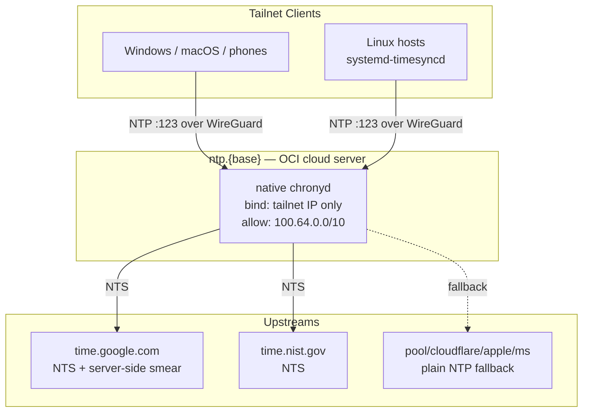
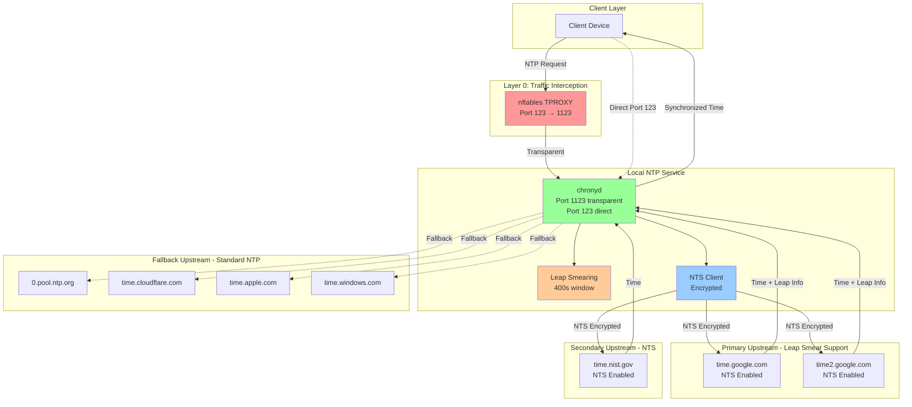
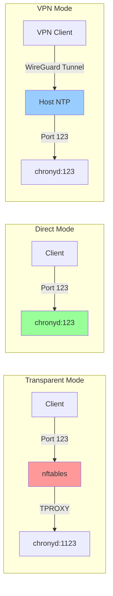
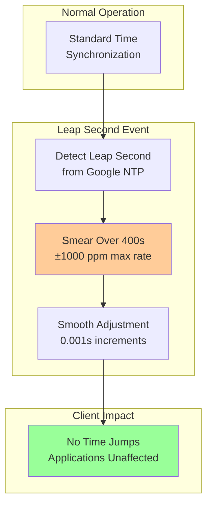
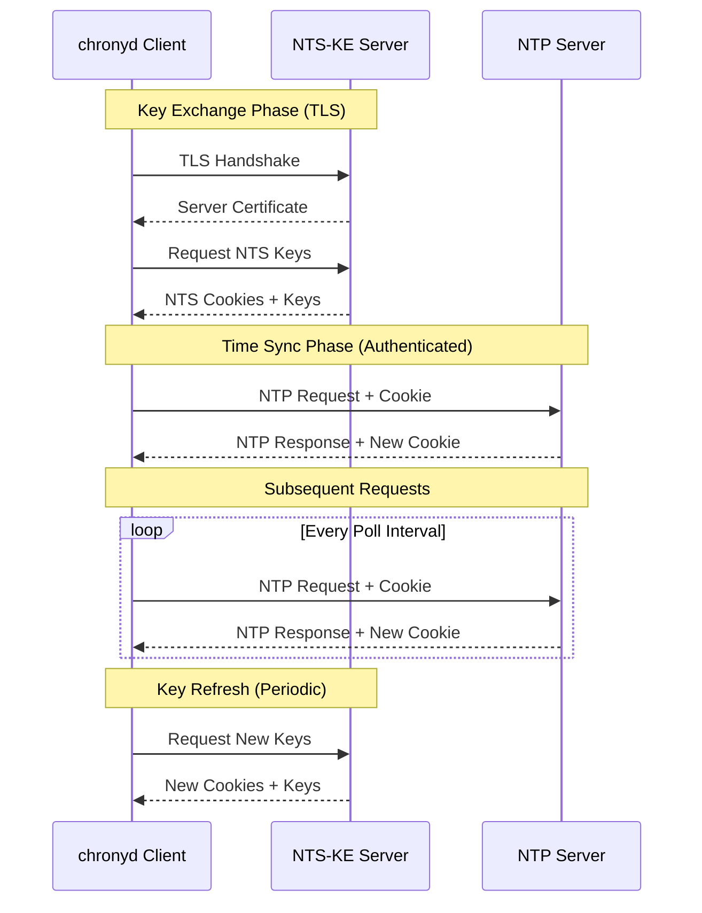
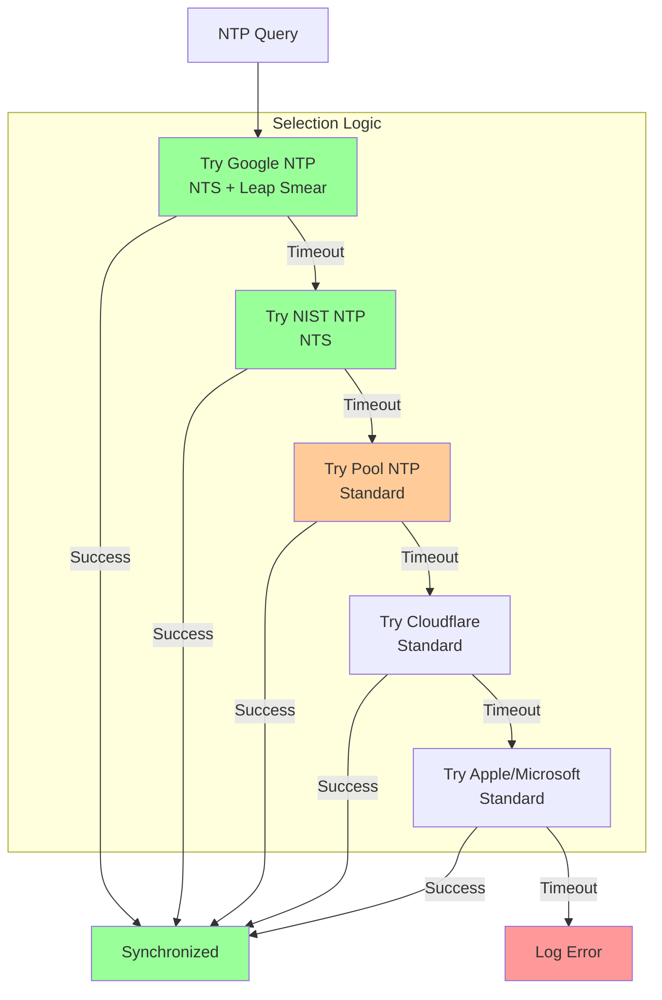

# NTP Time Synchronization Flow

## Tailnet NTP Server (`ntp.{base}`)

A dedicated tailnet-wide NTP server runs as **native chronyd** on the OCI
cloud server (`oci-cloud-server`), reachable at `ntp.{base}` (levonk:
`ntp.levonk.com`).

- **DNS**: A record → `infra_tailscale_ip_cloud_server` (not a CNAME to
  `*.ts.net` — MagicDNS intermittently NXDOMAINs tailnet names reached via
  cross-zone CNAME chase, and NTP clients resolve once then cache).
- **Tailnet-only**: chronyd `bindaddress` is limited to `127.0.0.1` + the
  tailnet IP, and `allow` is limited to the tailnet CIDR — public queries
  are silently dropped (no amplification reflector).
- **Upstream**: NTS to `time.google.com`/`time2.google.com`/`time.nist.gov`
  plus plain-NTP fallbacks (pool, Cloudflare, Apple, Microsoft).
- **Leap smearing happens here**: Google smears server-side and suppresses
  the leap flag; `smoothtime 400 0.001 leaponly` is the local safety net
  for non-smearing sources. Clients never see a leap flag or time jump —
  plain NTP consumers (Windows w32time, systemd-timesyncd, macOS timed)
  need no smear support.
- **Plain NTP inside the tailnet**: WireGuard already encrypts transport,
  so no NTS-KE listener is exposed to clients.
- **Not a container**: chronyd disciplines the host clock (a container
  would need SYS_TIME to mutate the same clock anyway). systemd-timesyncd
  on the same host is masked — one daemon per clock.
- **Clients**: tailnet devices point at `ntp.{base}` (or the tailnet IP
  directly for zero DNS dependency) and keep pool fallbacks so the server
  is never a single point of failure.
- Deployed by `deploy-ntp.yml` (role `ntp-chronyd`), validated by
  `validate-ntp.yml` — `just ansible-deploy-ntp` /
  `just ansible-validate-ntp`.

## NTP Service Chain

## NTP Access Modes

## Leap Second Handling

## NTS (Network Time Security)

## Upstream Selection Strategy

